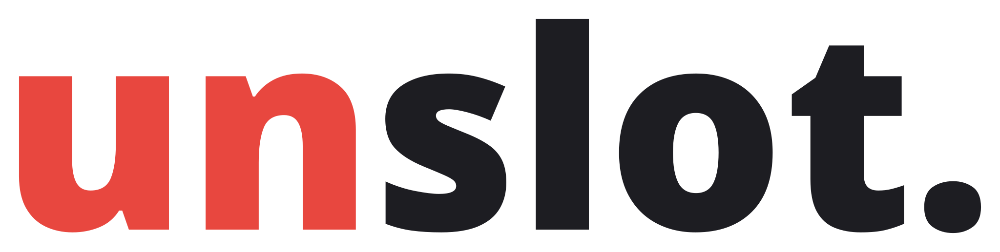
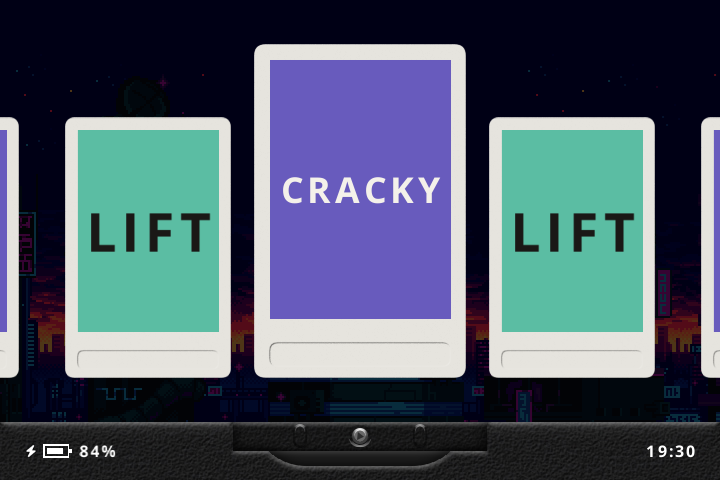
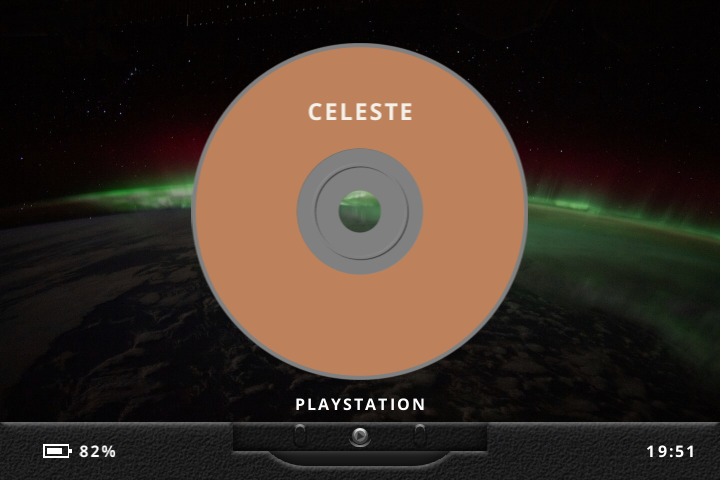
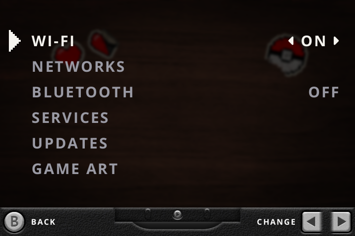
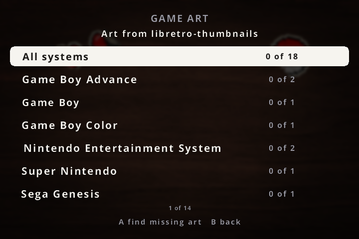
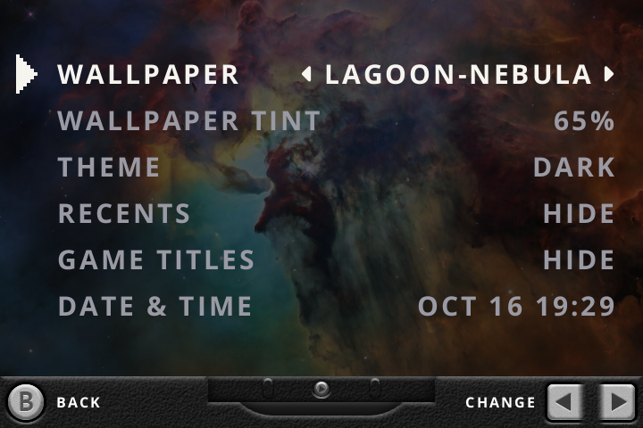
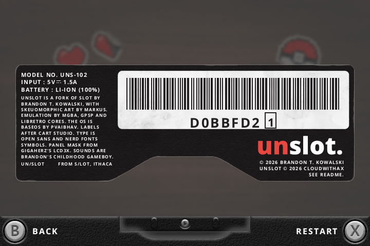

<picture>
  <source media="(prefers-color-scheme: dark)" srcset="assets/brand/unslot-dark.svg">
  
</picture>

**A skeuomorphic, multi-system frontend for Anbernic's H700 handhelds, running on [BaseOS](https://github.com/pvaibhav/BaseOS).**

A fork of [slot](https://github.com/BrandonKowalski/slot) that takes its cart shelves past the Game Boy:
thirteen systems, Wi-Fi and Bluetooth, analog sticks, network services and updates over the air.

---

## What it does

- **Fifty-five systems**, from arcade boards to the PSP, each on its own shelf as the media it came on: carts, cards, discs, floppies and tapes. Nintendo 64, Dreamcast and PSP draw on the GPU.
- **Wi-Fi** with an on-screen keyboard, and **Bluetooth** controllers and headphones.
- **Analog sticks** on the models that have them.
- **Services:** SSH and SFTP, sharing the card over SMB, Syncthing (add the device by scanning its ID), Tailscale (sign in by scanning a code) and WireGuard.
- **Updates over the air**, for unslot and for BaseOS under it, with an automatic rollback if a new version never starts.
- **Game Art** finds a label for each game online, matched by CRC and file name. It keeps going while you play, and each label shows on the shelf as soon as it is found.
- **Menu sounds and haptics:** recorded clicks of real buttons and switches, and a nudge of the rumble motor when a cart goes home or a setting changes. Both can be turned off in Settings → General.
- **Search:** X on the shelf finds a game by name on every system's shelf, with each result's cart, card or disc beside it, and A takes the slot to it.
- **Wallpapers:** a bundled set, or any PNG or JPG of your own.

Everything slot does is still here: the carts, the shelves, the link cable, the in-game menu and the save handling.

## Install

unslot runs on BaseOS, so it needs BaseOS on the card in TF1 first.

**New card.** Flash the release's `unslot-<version>-<model>.img.zip` for your model to TF1: it is BaseOS with unslot already on it. Boot it once and it grows to fill the card. Its unslot space is ext4, which a reset mid-write cannot corrupt but Windows and macOS cannot open, so add games over File sharing or Syncthing. Or flash your model's BaseOS image yourself, boot it once, and copy the contents of a release's `unslot-<version>` folder onto its `BASEOS` volume (or onto a card in TF2), add games and restart.

**Already running unslot?** Settings → Network → Updates downloads the new release's `unslot-<version>.pak` and installs it when you restart. Or copy the `.pak` to the root of the card yourself and restart with the power connected. `System/` is replaced, and your games, saves, labels and settings stay.

A `.pak` is the release's `MinUI.zip`, untouched, with its version and checksum signed by unslot's release key. unslot installs one only if the signature, version and zip all check out. Anything else is renamed `.bad`, logged in `Logs/update.log`, and never installed.

**Already running slot?** Copy the release's `MinUI.zip` to the root of the card and restart with the power connected. BaseOS installs it before the frontend starts.

> [!IMPORTANT]
> Unzip your ROMs, except for the systems whose games are zips: arcade, Neo Geo and CPS sets as the cores name them (FinalBurn Neo's sets, or MAME 2003-Plus's), and DOS and Amiga games packed that way.

## Systems

| System | Folder | Files | Core | BIOS |
|---|---|---|---|---|
| Game Boy Advance | `GBA` | `.gba` | mGBA, gpSP | `gba_bios.bin` (optional) |
| Game Boy | `GB` | `.gb`, `.gbc` | mGBA | |
| Game Boy Color | `GBC` | `.gb`, `.gbc` | mGBA | |
| Nintendo Entertainment System | `NES` | `.nes`, `.unf`, `.unif` | FCEUmm | |
| Super Nintendo | `SNES` | `.sfc`, `.smc` | Snes9x | |
| Sega Genesis / Mega Drive | `MD` | `.md`, `.gen`, `.bin`, `.smd` | Genesis Plus GX | |
| Sega Master System | `SMS` | `.sms` | Genesis Plus GX | |
| Sega Game Gear | `GG` | `.gg` | Genesis Plus GX | |
| PC Engine / TurboGrafx-16 | `PCE` | `.pce` | Beetle PCE Fast | |
| Neo Geo Pocket (Color) | `NGP` | `.ngp`, `.ngc` | RACE | |
| WonderSwan (Color) | `WS` | `.ws`, `.wsc` | Beetle Cygne | |
| Atari Lynx | `LYNX` | `.lnx` | Handy | `lynxboot.img` (required) |
| PlayStation | `PS` | `.cue`, `.chd`, `.pbp`, `.m3u` | PCSX ReARMed | `scph5501.bin` etc. (optional) |
| Arcade | `ARCADE` | `.zip`, `.7z` | FinalBurn Neo, MAME 2003-Plus | board BIOS zips beside the games, e.g. `pgm.zip` |
| Capcom CPS-1 | `CPS1` | `.zip`, `.7z` | FinalBurn Neo, MAME 2003-Plus |  |
| Capcom CPS-2 | `CPS2` | `.zip`, `.7z` | FinalBurn Neo, MAME 2003-Plus |  |
| Capcom CPS-3 | `CPS3` | `.zip`, `.7z` | FinalBurn Neo |  |
| Neo Geo | `NEOGEO` | `.zip`, `.7z` | FinalBurn Neo, MAME 2003-Plus | `neogeo.zip` beside the games or in `BIOS/fbneo` (required) |
| Neo Geo CD | `NEOCD` | `.cue`, `.chd` | NeoCD | in `BIOS/neocd`: one of `neocd_f.rom`, `neocd_sf.rom`, `neocd_t.rom`, `neocd_st.rom`, `neocd_z.rom`, `neocd_sz.rom`, `front-sp1.bin`, `top-sp1.bin`, `neocd.bin`, `uni-bioscd.rom`, and `ng-lo.rom` or `000-lo.lo` (required) |
| Famicom Disk System | `FDS` | `.fds` | FCEUmm | `disksys.rom` (required) |
| Nintendo 64 | `N64` | `.n64`, `.v64`, `.z64` | ParaLLEl N64 |  |
| Virtual Boy | `VB` | `.vb`, `.vboy` | Beetle VB |  |
| Pokémon mini | `POKEMINI` | `.min` | PokeMini |  |
| Game & Watch | `GW` | `.mgw` | Game & Watch |  |
| Sega 32X | `32X` | `.32x` | PicoDrive |  |
| Sega CD / Mega-CD | `SEGACD` | `.cue`, `.chd`, `.iso`, `.m3u` | Genesis Plus GX, PicoDrive | one of `bios_CD_U.bin`, `bios_CD_E.bin`, `bios_CD_J.bin` (required) |
| SG-1000 | `SG1000` | `.sg` | Genesis Plus GX, Gearsystem |  |
| Dreamcast | `DC` | `.chd`, `.cdi`, `.gdi`, `.cue`, `.m3u` | Flycast | `dc/dc_boot.bin`, `dc/dc_flash.bin` (optional) |
| PC Engine CD | `PCECD` | `.cue`, `.ccd`, `.chd`, `.toc`, `.m3u` | Beetle PCE Fast | `syscard3.pce` (required) |
| SuperGrafx | `SGFX` | `.sgx`, `.pce` | Beetle SuperGrafx |  |
| PC-FX | `PCFX` | `.cue`, `.ccd`, `.toc`, `.chd` | Beetle PC-FX | `pcfx.rom` (required) |
| Atari 2600 | `A2600` | `.a26`, `.bin` | Stella 2014 |  |
| Atari 5200 | `A5200` | `.a52`, `.bin` | a5200 | `5200.rom` (required) |
| Atari 7800 | `A7800` | `.a78`, `.bin` | ProSystem | `7800 BIOS (U).rom` (optional) |
| Atari 800 / XL / XE | `A800` | `.atr`, `.xex`, `.xfd`, `.cas`, `.bin`, `.car` | Atari800 | `ATARIXL.ROM`, `ATARIBAS.ROM` (optional) |
| Atari ST | `ATARIST` | `.st`, `.msa`, `.stx`, `.dim`, `.ipf` | Hatari B | `tos.img` (optional; EmuTOS is built in) |
| ColecoVision | `COLECO` | `.col`, `.cv`, `.bin`, `.rom` | Gearcoleco | `colecovision.rom` (required) |
| Intellivision | `INTV` | `.int`, `.bin`, `.rom` | FreeIntv | `exec.bin` and `grom.bin` (required) |
| Vectrex | `VECTREX` | `.vec`, `.bin` | vecx |  |
| Odyssey² / Videopac | `ODYSSEY` | `.bin` | O2EM | `o2rom.bin` (required) |
| Channel F | `CHANNELF` | `.bin`, `.chf` | FreeChaF | `sl31254.bin`, and `sl31253.bin` or `sl90025.bin` (required) |
| Watara Supervision | `SUPERVISION` | `.sv`, `.bin` | Potator |  |
| Mega Duck | `MEGADUCK` | `.bin`, `.duck` | SameDuck |  |
| MSX / MSX2 | `MSX` | `.rom`, `.mx1`, `.mx2`, `.dsk`, `.cas` | fMSX, blueMSX | `MSX.ROM`, `MSX2.ROM`, `MSX2EXT.ROM` (required by fMSX); blueMSX wants its `Machines` and `Databases` folders |
| Commodore 64 | `C64` | `.d64`, `.t64`, `.prg`, `.crt`, `.tap`, `.d81`, `.m3u` | VICE x64 |  |
| Amiga | `AMIGA` | `.adf`, `.hdf`, `.lha`, `.ipf`, `.m3u`, `.zip` | PUAE 2021 | `kick34005.A500` etc. (optional; AROS is built in) |
| ZX Spectrum | `ZXS` | `.tzx`, `.tap`, `.z80`, `.sna`, `.dsk`, `.scl`, `.trd` | Fuse |  |
| Amstrad CPC | `CPC` | `.dsk`, `.cdt`, `.sna`, `.m3u` | Caprice32 |  |
| DOS | `DOS` | `.zip`, `.dosz`, `.exe`, `.com`, `.bat`, `.iso`, `.cue`, `.img`, `.conf` | DOSBox Pure |  |
| PC-98 | `PC98` | `.d98`, `.fdi`, `.hdi`, `.hdm`, `.fdd`, `.nhd`, `.thd`, `.m3u` | Neko Project II Kai | `np2kai/font.bmp` or `np2kai/FONT.ROM` (required), `np2kai/bios.rom` etc. |
| Sharp X68000 | `X68000` | `.dim`, `.xdf`, `.hdm`, `.hdf`, `.2hd`, `.m3u` | PX68k | `keropi/iplrom.dat` and `keropi/cgrom.dat` (required) |
| ScummVM | `SCUMMVM` | `.scummvm` | ScummVM |  |
| PICO-8 | `PICO8` | `.p8`, `.png` | Retro8 |  |
| TIC-80 | `TIC80` | `.tic` | TIC-80 |  |
| PlayStation Portable | `PSP` | `.iso`, `.cso`, `.pbp`, `.chd` | PPSSPP |  |

## On the card

| Folder | What goes there |
|---|---|
| `Games/<Folder>` | Your games, by the folder in the table above. A multi-disc game goes in once, as an `.m3u` playlist; swap discs from Gameplay in the game menu. |
| `Labels/<Folder>` | A label for a game, as `<game>.png`. Game Art fills these in for you. |
| `BIOS` | BIOS files, by the names in the table above, some in a folder of the core's. |
| `Wallpapers` | Your own wallpapers, PNG or JPG. |
| `Config/wireguard` | WireGuard tunnels, as wg-quick `.conf` files. |
| `Config/screenscraper.conf` | Your ScreenScraper login (`ssid=`, `sspassword=`), which you can also enter from Game Art's ScreenScraper row, and optionally a developer ID (`devid=`, `devpassword=`) to use in place of the one built into the release. With both, Game Art asks ScreenScraper first. |
| `System` | unslot itself. Updates replace it whole. |

## A look around

These are screenshots from an RG34XX SP.

## Devices

unslot targets every H700 model BaseOS supports. It has been run on the **RG34XX SP**. slot itself supports the RG SP, RG34XX, RG34XX SP, RG35XX SP, RG35XX Plus and RG28XX. If you try unslot on another model, [open an issue](https://github.com/cloudwithax/unslot/issues) and say how it went.

## Building

Builds use [Task](https://taskfile.dev). The device build runs in an arm64 Debian container, natively or through Docker.

| Task | What it makes |
|---|---|
| `task dist:device` | The card tree in `dist-device`. |
| `task dist:update` | The update pack, `MinUI.zip`. |
| `task image:device TARGET=rg34xxsp` | A whole card image to flash to TF1: BaseOS with unslot already on it (Linux only). |
| `task test` | The tests. |

## Credits

unslot is a fork of **[slot](https://github.com/BrandonKowalski/slot)** by Brandon T. Kowalski. Its skeuomorphic art is by **[Markus](https://github.com/MarkusMaribu)**, and the carts, shelves, link cable and most of what you see came from slot.

| Area | Credit |
|---|---|
| Operating system | [BaseOS](https://github.com/pvaibhav/BaseOS) by pvaibhav |
| Emulation | [mGBA](https://mgba.io), [gpSP](https://github.com/libretro/gpsp), and the libretro cores in the systems table |
| Labels | Game Art's style follows [Cart Studio](https://github.com/BrandonKowalski/slot-cart-studio). Names come from [libretro-database](https://github.com/libretro/libretro-database) and art from libretro-thumbnails and [ScreenScraper](https://www.screenscraper.fr). |
| Services | [Syncthing](https://syncthing.net), [Tailscale](https://github.com/tailscale/tailscale), [wireguard-go](https://git.zx2c4.com/wireguard-go) and [spruceOS](https://github.com/spruceUI/spruceOS)'s Samba build, with glibc's libnsl from Ubuntu |
| Wallpapers | NASA, ESA, CSA and STScI; Poly Haven; ambientCG; and Luis Zuno. Each is credited in `System/licenses/wallpapers.txt`. |
| Type | Open Sans, and Nerd Fonts Symbols by Ryan L McIntyre |
| Sounds | The cart's sounds are slot's. The menu's are CC0 recordings from Freesound by 5ro4, Nekkowe, greatsoundstube and BenjaminNelan, credited in `System/licenses/sounds.txt`. |

Every licence, with gpSP's source, ships in `System/licenses/`.

## AI disclosure

Like slot, unslot is largely written by AI. unslot's additions were written with Claude, directed and tested on hardware by its maintainer. slot's own disclosure, and its author's reasons, are in [slot's README](https://github.com/BrandonKowalski/slot#ai-disclosure).

## Licence

GPL-3.0, as slot. See [LICENSE](LICENSE).
