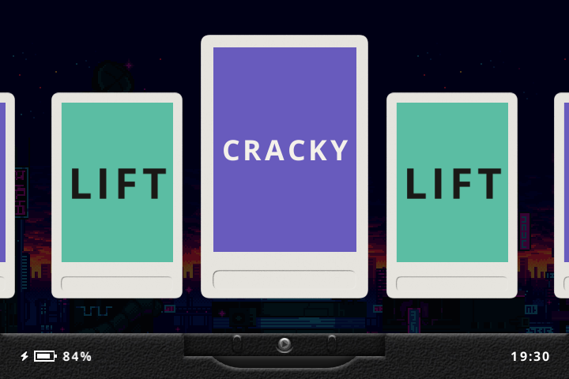
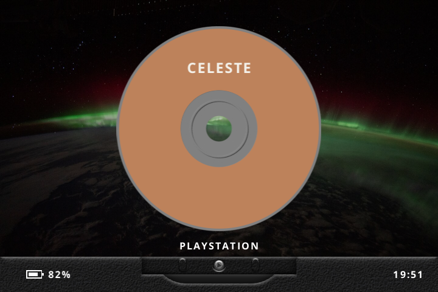
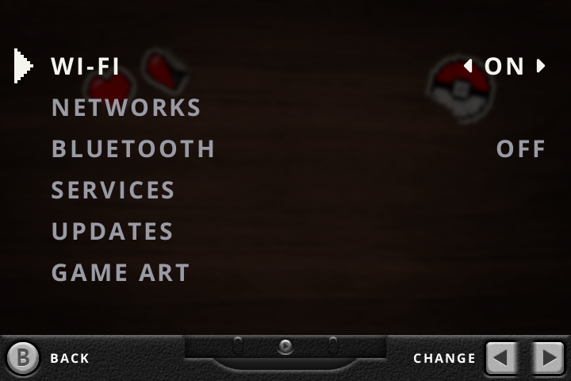
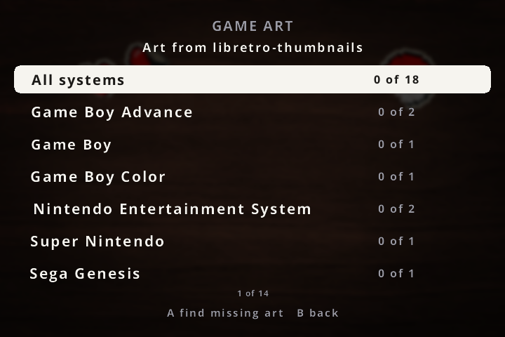
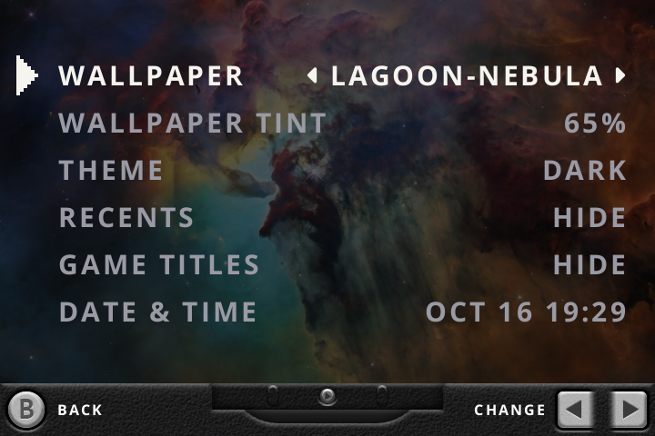
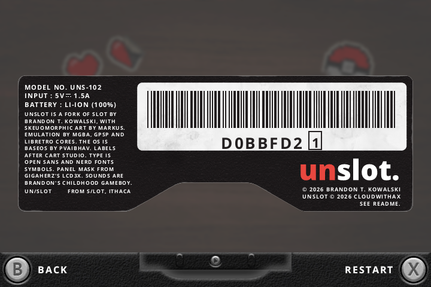

<picture>
  <source media="(prefers-color-scheme: dark)" srcset="assets/brand/unslot-dark.svg">
  
</picture>

**A skeuomorphic, multi-system frontend for Anbernic's H700 handhelds, running on [BaseOS](https://github.com/pvaibhav/BaseOS).**

A fork of [slot](https://github.com/BrandonKowalski/slot) that takes its cart shelves far past the
Game Boy: **fifty-six systems**, from arcade boards to the PSP, with Wi-Fi and Bluetooth, analog
sticks, search across every shelf, RetroAchievements, bezels, casting to a TV, network services and
signed updates over the air.

---

## What it does

- **Fifty-six systems**, from arcade boards to the PSP, each on its own shelf as the media it came on: carts, cards, discs, floppies and tapes. Nintendo 64, Dreamcast and PSP draw on the GPU. The DS runs in DraStic, with unslot's menu on Menu and DraStic's on Select + X.
- **Wi-Fi** with an on-screen keyboard, and **Bluetooth** controllers and headphones.
- **Analog sticks** on the models that have them.
- **Services:** SSH and SFTP, sharing the card over SMB, Syncthing (add the device by scanning its ID), Tailscale (sign in by scanning a code) and WireGuard.
- **Updates over the air**, for unslot and for BaseOS under it, with an automatic rollback if a new version never starts.
- **Game Art** finds a label for each game online, matched by CRC and file name. It keeps going while you play, and each label shows on the shelf as soon as it is found.
- **Menu sounds and haptics:** recorded clicks of real buttons and switches, and a nudge of the rumble motor when a cart goes home or a setting changes. Both can be turned off in Settings → General.
- **Search:** X on the shelf finds a game by name on every system's shelf, with each result's cart, card or disc beside it, and A takes the slot to it.
- **RetroAchievements**, softcore or hardcore, and they keep working offline once a game's set is cached.
- **Bezels** for every system, with R. Savant's H700 overlay pack built in, and **custom shaders** from RetroArch `.glsl` files.
- **Apps:** Files, Books, Manuals, Gallery and Music on their own shelf, plus PortMaster-style ports in `Ports`.
- **Cast to a TV** over Wi-Fi, to a Chromecast or Google TV, or to a Miracast TV over Wi-Fi Direct.
- **Controls:** remap the game's buttons for every game, for one system or for one game, and use the D-pad as the left stick on handhelds without one.
- **Upload from Phone:** scan a code to send the card a game, a wallpaper or a bezel from a phone on the same Wi-Fi.
- **Wallpapers:** a bundled set, or any PNG or JPG of your own.

Everything slot does is still here: the carts, the shelves, the link cable, the in-game menu and the save handling.

## Apps, artwork and screen effects

The **Apps** shelf contains Files, Books, Manuals, Gallery and Music, plus ports in `Ports`. Each
opens directly from its cart and returns to the shelf with B. Books reads text, EPUBs and PDFs and
keeps your page; Gallery shows the pictures in `Pictures`, and videos play there with L1 and R1
skipping ten seconds; Music plays on with its page closed and holds while a game runs. Ports are
laid out as PortMaster does and run with unslot closed, which comes back when they end. PDF reading
and video playback use the bundled `System/bin/mutool` and `System/bin/ffmpeg`.

**Settings → Online** holds Upload from Phone, Game Art, Art While Asleep, RetroAchievements,
Updates, Cores and **Auto-Update Cores**, which fetches new builds of the cores on the card once a
start has the Wi-Fi up. Game Art's **Clear All Art** takes every label off the card, on a second
press. Settings → Network keeps Wi-Fi, Bluetooth, Cast and services.

Turn on **Art While Asleep** to find missing labels during standby with Wi-Fi connected. The
search postpones shutdown while charging or above 20% battery. The normal idle
timeout starts again after scraping finishes.

**Controls:** remap which of the handheld's buttons presses each of the game's sixteen, under
Settings → Gameplay → Controls. Maps live in `Config/Remaps`, which an update leaves alone, as
`All.txt` for every game, `<SYSTEM>.txt` for a system and `<SYSTEM>/<game>.txt` for one game.
**D-Pad as Stick**, beside it, moves the left stick with the D-pad on a handheld that has no
analog stick.

**Cast to a TV**, under Settings → Network → Cast, or from the menu over a game. Chromecasts and
Google TVs are listed with TVs and projectors that take Miracast over Wi-Fi Direct, which are
marked Miracast; the handheld's screen goes over at 640 by 480 and up to 60 fps, less in the
heaviest games, with the sound as AAC to a TV that takes it and LPCM to the rest. Wi-Fi Direct uses
the second radio, so the home Wi-Fi stays connected. A TV that insists on the handheld leading the
Wi-Fi Direct group is not cast to. The footer shows a cast icon while the screen is on a TV, and
**Sound on TV** under Settings → General decides whether the sound follows the picture.

**The SP's slot** comes in Graphite, Platinum, Pearl Pink, Pearl Blue and Pearl Blue Dark, and
slots of your own can be added to the card.

**Custom shaders:** put single-pass RetroArch `.glsl` files in `Shaders/`, or a `.glslp` preset
with `shaders = 1`, its `shader0` file and optional `filter_linear0 = true`. Choose the file after
the built-in effects under Settings → Screen → the system → Shader, or the in-game Screen page.
Shader parameters use their declared defaults. Multi-pass presets and Slang shaders are not supported.
If a shader cannot compile, the built-in effect remains available and `Logs/slot.log` records why.

**Bezels:** each system's Screen settings, and the Screen page in the menu over a game, have a
Bezel row. R. Savant's Anbernic H700 Overlays pack is built in at 640 by 480, 720 by 480 and 720 by
720 for the NES, SNES, Genesis and Mega Drive, Master System, Game Gear, PC Engine, the Game Boy
family, Neo Geo, WonderSwan and more. The game is drawn in the bezel's window, as RetroArch does,
with the bezel over the whole screen; Stretch shows the game without it.

**Custom bezels:** place PNGs and optional `.info` files in `Bezels/<system>/`. With a KNULLI or
Batocera `.info` beside it the game goes where that says, else in the PNG's clear middle. A
RetroArch `.cfg`
can name its picture with `overlay0_overlay`; a custom viewport is used when present. This imports
the artwork, not touch controls or multiple overlay layers. Settings → Online → Upload from Phone
accepts bezels as well as games and wallpapers; send the PNG and any accompanying `.info` or `.cfg`.

**Achievements:** sign in under Settings → Online → RetroAchievements. Play is softcore unless you
turn on **Hardcore Achievements** under Settings → Gameplay; turning it on takes effect from the
next game, and turning it off counts at once. In hardcore nothing may rewind or load a state, so
the States page hides Load, and, as in RetroArch, a little play is wanted between pauses, so that
pausing cannot step through a game a few frames at a time.

A ROM or disc whose hash RetroAchievements does not know, often another region's release, falls back
to the set of the game of the same title there, in softcore, as another release's memory may not
line up for every achievement.

**Offline achievements:** launch a game online once to cache its achievement definitions. Supported
cores can then earn achievements offline, including after a restart. Unsent awards remain in
`Config/retroachievements/` until the service confirms them; reconnecting retries them. Keep that
folder with your saves. Passwords are not saved. Games whose definitions have never been cached
still need an initial connection.

## Install

unslot runs on BaseOS, so it needs BaseOS on the card in TF1 first.

**New card.** Flash the release's `unslot-<version>-<model>.img.zip` for your model to TF1: it is BaseOS with unslot already on it. Boot it once and it grows to fill the card. Its unslot space is ext4, which a reset mid-write cannot corrupt but Windows and macOS cannot open, so add games over File sharing or Syncthing. Or flash your model's BaseOS image yourself, boot it once, and copy the contents of a release's `unslot-<version>` folder onto its `BASEOS` volume (or onto a card in TF2), add games and restart.

**Already running unslot?** Settings → Online → Updates downloads the new release's `unslot-<version>.pak` and installs it when you restart. Or copy the `.pak` to the root of the card yourself and restart with the power connected. `System/` is replaced, and your games, saves, labels and settings stay.

A `.pak` is the release's `MinUI.zip`, untouched, with its version and checksum signed by unslot's release key. unslot installs one only if the signature, version and zip all check out. Anything else is renamed `.bad`, logged in `Logs/update.log`, and never installed.

**Already running slot?** Copy the release's `MinUI.zip` to the root of the card and restart with the power connected. BaseOS installs it before the frontend starts.

> [!IMPORTANT]
> Unzip your ROMs, except for the systems whose games are zips: arcade, Neo Geo and CPS sets as the cores name them (FinalBurn Neo's sets, or MAME 2003-Plus's), and DOS and Amiga games packed that way.

## Systems

| System | Folder | Files | Core | BIOS |
|---|---|---|---|---|
| Game Boy Advance | `GBA` | `.gba` | mGBA, gpSP | `gba_bios.bin` (optional) |
| Game Boy | `GB` | `.gb`, `.gbc` | mGBA | |
| Game Boy Color | `GBC` | `.gb`, `.gbc` | mGBA | |
| Nintendo Entertainment System | `NES` | `.nes`, `.unf`, `.unif` | FCEUmm | |
| Super Nintendo | `SNES` | `.sfc`, `.smc` | Snes9x | |
| Sega Genesis / Mega Drive | `MD` | `.md`, `.gen`, `.bin`, `.smd` | Genesis Plus GX | |
| Sega Master System | `SMS` | `.sms` | Genesis Plus GX | |
| Sega Game Gear | `GG` | `.gg` | Genesis Plus GX | |
| PC Engine / TurboGrafx-16 | `PCE` | `.pce` | Beetle PCE Fast | |
| Neo Geo Pocket (Color) | `NGP` | `.ngp`, `.ngc` | RACE | |
| WonderSwan (Color) | `WS` | `.ws`, `.wsc` | Beetle Cygne | |
| Atari Lynx | `LYNX` | `.lnx` | Handy | `lynxboot.img` (required) |
| PlayStation | `PS` | `.cue`, `.chd`, `.pbp`, `.m3u` | PCSX ReARMed | `scph5501.bin` etc. (optional) |
| Arcade | `ARCADE` | `.zip`, `.7z` | FinalBurn Neo, MAME 2003-Plus | board BIOS zips beside the games, e.g. `pgm.zip` |
| Capcom CPS-1 | `CPS1` | `.zip`, `.7z` | FinalBurn Neo, MAME 2003-Plus |  |
| Capcom CPS-2 | `CPS2` | `.zip`, `.7z` | FinalBurn Neo, MAME 2003-Plus |  |
| Capcom CPS-3 | `CPS3` | `.zip`, `.7z` | FinalBurn Neo |  |
| Neo Geo | `NEOGEO` | `.zip`, `.7z` | FinalBurn Neo, MAME 2003-Plus | `neogeo.zip` beside the games or in `BIOS/fbneo` (required) |
| Neo Geo CD | `NEOCD` | `.cue`, `.chd` | NeoCD | in `BIOS/neocd`: one of `neocd_f.rom`, `neocd_sf.rom`, `neocd_t.rom`, `neocd_st.rom`, `neocd_z.rom`, `neocd_sz.rom`, `front-sp1.bin`, `top-sp1.bin`, `neocd.bin`, `uni-bioscd.rom`, and `ng-lo.rom` or `000-lo.lo` (required) |
| Famicom Disk System | `FDS` | `.fds` | FCEUmm | `disksys.rom` (required) |
| Nintendo 64 | `N64` | `.n64`, `.v64`, `.z64` | ParaLLEl N64 |  |
| Nintendo DS | `NDS` | `.nds` | DraStic |  |
| Virtual Boy | `VB` | `.vb`, `.vboy` | Beetle VB |  |
| Pokémon mini | `POKEMINI` | `.min` | PokeMini |  |
| Game & Watch | `GW` | `.mgw` | Game & Watch |  |
| Sega 32X | `32X` | `.32x` | PicoDrive |  |
| Sega CD / Mega-CD | `SEGACD` | `.cue`, `.chd`, `.iso`, `.m3u` | Genesis Plus GX, PicoDrive | one of `bios_CD_U.bin`, `bios_CD_E.bin`, `bios_CD_J.bin` (required) |
| SG-1000 | `SG1000` | `.sg` | Genesis Plus GX, Gearsystem |  |
| Dreamcast | `DC` | `.chd`, `.cdi`, `.gdi`, `.cue`, `.m3u` | Flycast | `dc/dc_boot.bin`, `dc/dc_flash.bin` (optional) |
| PC Engine CD | `PCECD` | `.cue`, `.ccd`, `.chd`, `.toc`, `.m3u` | Beetle PCE Fast | `syscard3.pce` (required) |
| SuperGrafx | `SGFX` | `.sgx`, `.pce` | Beetle SuperGrafx |  |
| PC-FX | `PCFX` | `.cue`, `.ccd`, `.toc`, `.chd` | Beetle PC-FX | `pcfx.rom` (required) |
| Atari 2600 | `A2600` | `.a26`, `.bin` | Stella 2014 |  |
| Atari 5200 | `A5200` | `.a52`, `.bin` | a5200 | `5200.rom` (required) |
| Atari 7800 | `A7800` | `.a78`, `.bin` | ProSystem | `7800 BIOS (U).rom` (optional) |
| Atari 800 / XL / XE | `A800` | `.atr`, `.xex`, `.xfd`, `.cas`, `.bin`, `.car` | Atari800 | `ATARIXL.ROM`, `ATARIBAS.ROM` (optional) |
| Atari ST | `ATARIST` | `.st`, `.msa`, `.stx`, `.dim`, `.ipf` | Hatari B | `tos.img` (optional; EmuTOS is built in) |
| ColecoVision | `COLECO` | `.col`, `.cv`, `.bin`, `.rom` | Gearcoleco | `colecovision.rom` (required) |
| Intellivision | `INTV` | `.int`, `.bin`, `.rom` | FreeIntv | `exec.bin` and `grom.bin` (required) |
| Vectrex | `VECTREX` | `.vec`, `.bin` | vecx |  |
| Odyssey² / Videopac | `ODYSSEY` | `.bin` | O2EM | `o2rom.bin` (required) |
| Channel F | `CHANNELF` | `.bin`, `.chf` | FreeChaF | `sl31254.bin`, and `sl31253.bin` or `sl90025.bin` (required) |
| Watara Supervision | `SUPERVISION` | `.sv`, `.bin` | Potator |  |
| Mega Duck | `MEGADUCK` | `.bin`, `.duck` | SameDuck |  |
| MSX / MSX2 | `MSX` | `.rom`, `.mx1`, `.mx2`, `.dsk`, `.cas` | fMSX, blueMSX | `MSX.ROM`, `MSX2.ROM`, `MSX2EXT.ROM` (required by fMSX); blueMSX wants its `Machines` and `Databases` folders |
| Commodore 64 | `C64` | `.d64`, `.t64`, `.prg`, `.crt`, `.tap`, `.d81`, `.m3u` | VICE x64 |  |
| Amiga | `AMIGA` | `.adf`, `.hdf`, `.lha`, `.ipf`, `.m3u`, `.zip` | PUAE 2021 | `kick34005.A500` etc. (optional; AROS is built in) |
| ZX Spectrum | `ZXS` | `.tzx`, `.tap`, `.z80`, `.sna`, `.dsk`, `.scl`, `.trd` | Fuse |  |
| Amstrad CPC | `CPC` | `.dsk`, `.cdt`, `.sna`, `.m3u` | Caprice32 |  |
| DOS | `DOS` | `.zip`, `.dosz`, `.exe`, `.com`, `.bat`, `.iso`, `.cue`, `.img`, `.conf` | DOSBox Pure |  |
| PC-98 | `PC98` | `.d98`, `.fdi`, `.hdi`, `.hdm`, `.fdd`, `.nhd`, `.thd`, `.m3u` | Neko Project II Kai | `np2kai/font.bmp` or `np2kai/FONT.ROM` (required), `np2kai/bios.rom` etc. |
| Sharp X68000 | `X68000` | `.dim`, `.xdf`, `.hdm`, `.hdf`, `.2hd`, `.m3u` | PX68k | `keropi/iplrom.dat` and `keropi/cgrom.dat` (required) |
| ScummVM | `SCUMMVM` | `.scummvm` | ScummVM |  |
| PICO-8 | `PICO8` | `.p8`, `.png` | Retro8 |  |
| TIC-80 | `TIC80` | `.tic` | TIC-80 |  |
| PlayStation Portable | `PSP` | `.iso`, `.cso`, `.pbp`, `.chd` | PPSSPP |  |

## On the card

| Folder | What goes there |
|---|---|
| `Games/<Folder>` | Your games, by the folder in the table above. A multi-disc game goes in once, as an `.m3u` playlist; swap discs from Gameplay in the game menu. |
| `Labels/<Folder>` | A label for a game, as `<game>.png`. Game Art fills these in for you. Real carts and discs it fetches go in `Renders` beside them. |
| `Saves/<Folder>`, `States/<Folder>` | Saves and save states, by system. |
| `BIOS` | BIOS files, by the names in the table above, some in a folder of the core's. |
| `Wallpapers` | Your own wallpapers, PNG or JPG. |
| `Bezels/<Folder>` | Your own bezels, as PNGs with an optional `.info` or RetroArch `.cfg`. |
| `Shaders` | Single-pass RetroArch `.glsl` files, or a `.glslp` preset with its shader. |
| `Books`, `Manuals/<Folder>`, `Pictures`, `Music` | What the Books, Manuals, Gallery and Music apps read. Gallery plays videos from `Pictures` too. |
| `Ports` | Ports, laid out as PortMaster does. |
| `Config/Remaps` | Button maps: `All.txt`, `<SYSTEM>.txt` and `<SYSTEM>/<game>.txt`. |
| `Config/retroachievements` | Achievements earned offline, until the service confirms them. Keep it with your saves. |
| `Config/wireguard` | WireGuard tunnels, as wg-quick `.conf` files. |
| `Config/screenscraper.conf` | Your ScreenScraper login (`ssid=`, `sspassword=`), which you can also enter from Game Art's ScreenScraper row, and optionally a developer ID (`devid=`, `devpassword=`) to use in place of the one built into the release. With both, Game Art asks ScreenScraper first. |
| `System` | unslot itself. Updates replace it whole. |

## A look around

These are screenshots from an RG34XX SP.

## Devices

Every release ships a flashable card image for each of these eleven H700 models:

| | | |
|---|---|---|
| RG28XX | RG35XX Plus / 2024 | RG40XX H |
| RG34XX | RG35XX Pro | RG40XX V |
| RG34XX SP | RG35XX SP | RG CubeXX |
| RG35XX H | RG SP | |

One build runs on all of them: unslot reads the model from BaseOS at boot and lays itself out for
its panel, including the **RG CubeXX**'s square screen, where the shelf, menus and settings are laid
out at 720 by 720. It has been run on hardware on the **RG34XX SP**. If you try unslot on another
model, [open an issue](https://github.com/cloudwithax/unslot/issues) and say how it went.

## Building

Builds use [Task](https://taskfile.dev). The device build runs in an arm64 Debian container, natively or through Docker.

| Task | What it makes |
|---|---|
| `task dist:device` | The card tree in `dist-device`. |
| `task dist:update` | The update pack, `MinUI.zip`. |
| `task image:device TARGET=rg34xxsp` | A whole card image to flash to TF1: BaseOS with unslot already on it (Linux only). |
| `task test` | The tests. |

## Credits

unslot is a fork of **[slot](https://github.com/BrandonKowalski/slot)** by Brandon T. Kowalski. Its skeuomorphic art is by **[Markus](https://github.com/MarkusMaribu)**, and the carts, shelves, link cable and most of what you see came from slot.

| Area | Credit |
|---|---|
| Operating system | [BaseOS](https://github.com/pvaibhav/BaseOS) by pvaibhav |
| Emulation | [mGBA](https://mgba.io), [gpSP](https://github.com/libretro/gpsp), and the libretro cores in the systems table. The Dreamcast's [Nodosumi](https://github.com/cloudwithax/nodosumi) ships with each release, with Flycast as the other choice. The DS runs in Exophase's [DraStic](https://drastic-ds.com), by way of trngaje's [advanced_drastic](https://github.com/trngaje/advanced_drastic). |
| Achievements | [rcheevos](https://github.com/RetroAchievements/rcheevos) (MIT), by way of machomano's slot fork (GPL-3.0) |
| Bezels | [R. Savant's Anbernic H700 Overlays](https://github.com/RighteousSavant/Anbernic-H700-Overlays), free for any H700 handheld. The default bezel is "Perfect GBA SP" by mugwomp93, by way of chrizzo-hb's knulli-bezels (CC BY-SA 4.0). |
| Apps | [MuPDF](https://mupdf.com)'s `mutool` (AGPL-3.0) reads PDFs and [FFmpeg](https://ffmpeg.org) (GPL) plays video; ports follow [PortMaster](https://portmaster.games)'s layout |
| Labels | Game Art's style follows [Cart Studio](https://github.com/BrandonKowalski/slot-cart-studio). Names come from [libretro-database](https://github.com/libretro/libretro-database) and art from libretro-thumbnails and [ScreenScraper](https://www.screenscraper.fr). |
| Services | [Syncthing](https://syncthing.net), [Tailscale](https://github.com/tailscale/tailscale), [wireguard-go](https://git.zx2c4.com/wireguard-go) and [spruceOS](https://github.com/spruceUI/spruceOS)'s Samba build, with glibc's libnsl from Ubuntu |
| Wallpapers | NASA, ESA, CSA and STScI; Poly Haven; ambientCG; and Luis Zuno. Each is credited in `System/licenses/wallpapers.txt`. |
| Type | Open Sans, and Nerd Fonts Symbols by Ryan L McIntyre |
| Sounds | The cart's sounds are slot's. The menu's are CC0 recordings from Freesound by 5ro4, Nekkowe, greatsoundstube and BenjaminNelan, credited in `System/licenses/sounds.txt`. |

Every licence, with gpSP's source, ships in `System/licenses/`.

## AI disclosure

Like slot, unslot is largely written by AI. unslot's additions were written with Claude, directed and tested on hardware by its maintainer. slot's own disclosure, and its author's reasons, are in [slot's README](https://github.com/BrandonKowalski/slot#ai-disclosure).

## Licence

GPL-3.0, as slot. See [LICENSE](LICENSE).
